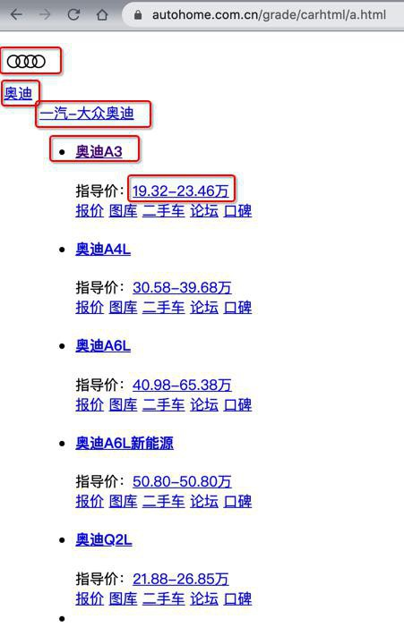
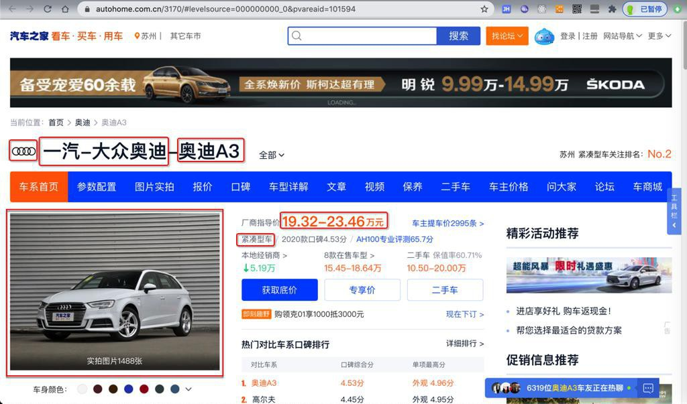
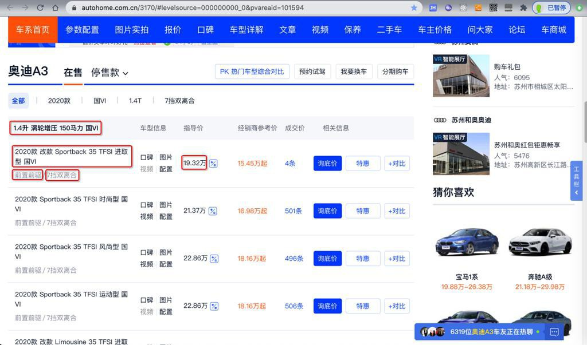
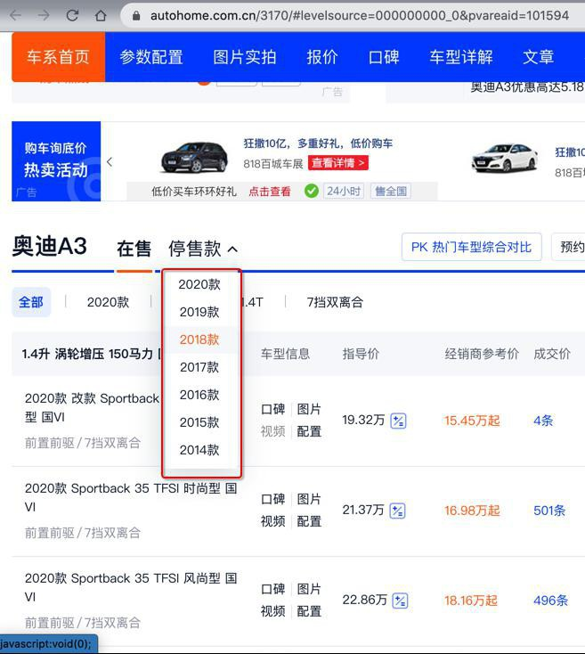
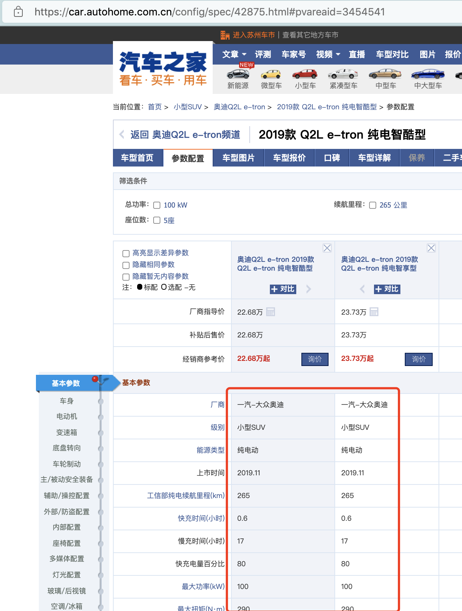
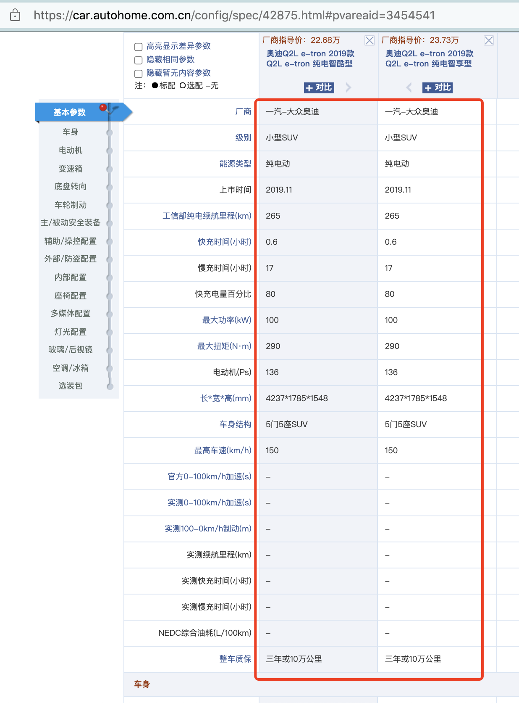

# 过程

本身汽车之家入口是

https://www.autohome.com.cn/car/

但是经研究，更利于爬虫抓取的是：

从：

https://www.autohome.com.cn/grade/carhtml/a.html

到：

https://www.autohome.com.cn/grade/carhtml/z.html

其中可以找到车系的数据：

对应的值分别是：

* `carBrandName`：奥迪
* `carBrandLogoUrl`：https://car2.autoimg.cn/cardfs/series/g26/M0B/AE/B3/100x100_f40_autohomecar__wKgHEVs9u5WAV441AAAKdxZGE4U148.png
* `carMerchantName`：一汽-大众奥迪
* `carMerchantUrl`：https://car.autohome.com.cn/price/brand-33-9.html#pvareaid=2042363
* `carSeriesName`：奥迪A3
* `carSeriesUrl`：https://www.autohome.com.cn/3170/#levelsource=000000000_0&pvareaid=101594
* `carSeriesMsrp`：19.32-23.46万
* `carSeriesMsrpUrl`：https://www.autohome.com.cn/3170/price.html#pvareaid=101446

然后进去车系主页=车系详情页

[【奥迪A3】奥迪_奥迪A3报价_奥迪A3图片_汽车之家](https://www.autohome.com.cn/3170/#levelsource=000000000_0&pvareaid=101594)

https://www.autohome.com.cn/3170/#levelsource=000000000_0&pvareaid=101594

可以抓取到：

* 汽车品牌Logo图片
* 汽车主品牌=主机厂=（汽车）厂商
* 车系
* 厂商指导价
* 汽车级别

以及页面下方的，全部的车系的数据：

可以抓取到：

* carModelGroupName：1.5升 涡轮增压 169马力 国VI
* carModelYear：2020款
* carModelEmissionStandards：国VI
* carModelPower：1.5T
* carModelGearBox：7挡双离合

如果历史车型很多，分多个年份，则还要切换年份后再抓取：

之后，还要抓取每个车型的详细配置参数：

[【奥迪Q2L e-tron 2019款 Q2L e-tron 纯电智酷型参数配置表】价格单_奥迪_汽车之家](https://car.autohome.com.cn/config/spec/42875.html#pvareaid=3454541)

https://car.autohome.com.cn/config/spec/42875.html#pvareaid=3454541

期间，有些内容的处理，还是很复杂的。

具体细节详见：

* 【未解决】用Python爬取汽车之家的车型车系详细数据
* 【已解决】Mac中恢复或重新搭建PySpider开发环境
* [【已解决】PySpider访问汽车之家报错：requests.exceptions.HTTPError HTTP 403 Forbidden](https://www.crifan.com/pyspider_visit_home_auto_error_requests_exceptions_httperror_http_403_forbidden)
* [【已解决】PySpider中获取PyQuery获取到节点的子元素](https://www.crifan.com/pyspider_fetches_child_elements_node_that_pyquery_fetches)
* [【已解决】PySpider中PyQuery如何匹配某个元素中多个属性值](https://www.crifan.com/how_does_pyquery_match_multiple_attribute_values_an_element_pyspider)
* [【已解决】汽车之家车型车系数据：支持新版车系页面](https://www.crifan.com/auto_family_car_series_data_support_new_version_car_series_page)
* [【已解决】汽车之家车型车系数据：支持旧版车系页面](https://www.crifan.com/auto_family_model_data_support_old_version_car_series_page)
* [【已解决】汽车之家车型车系数据：抓取车型的详细参数配置](https://www.crifan.com/auto_family_car_series_data_capture_detailed_parameter_configuration_car)
* [【未解决】汽车之家车型车系数据：想办法破解js和css加密的文字显示](https://www.crifan.com/auto_home_model_car_data_try_crack_js_css_encryption_text_display)
* [【已解决】汽车之家车型车系数据：解决部分车型基本参数字段个数不一致问题](https://www.crifan.com/auto_family_car_series_data_solve_problem_inconsistent_number_basic_parameter_fields_some_car_models)
* [【已解决】汽车之家车型车系数据：优化去掉js加速抓取车型参数配置](https://www.crifan.com/autohome_vehicle_data_optimize_removal_js_accelerate_capture_vehicle_parameters_configuration)
* [【规避解决】汽车之家配置页面无法直接获取到文字数据](https://www.crifan.com/autohome_configuration_page_can_not_directly_get_text_data)
* [【已解决】汽车之家车型车系数据：carBrandId是空](https://www.crifan.com/car_series_data_carbrandid_empty)
* [【未解决】汽车之家车型车系数据：能源类型是空白的车型](https://www.crifan.com/car_series_data_autohome_models_energy_type_blank)
* [【已解决】汽车之家车型车系数据：车身结构的值包含span标签](https://www.crifan.com/autohome_model_series_data_value_body_structure_contains_span_tag)
* [【未解决】汽车之家车型车系数据：有些参数字段的值包含span特殊标签](https://www.crifan.com/autohome_model_series_data_values_some_parameter_fields_contain_span_special_tag)
* [【已解决】汽车之家车型车系数据：抓取车型的详细参数配置](https://www.crifan.com/auto_family_car_series_data_capture_detailed_parameter_configuration_car)
* [【已解决】车型车系数据缺失如红旗H5等部分车型数据](https://www.crifan.com/data_some_models_such_as_hongqi_h5_missing)
