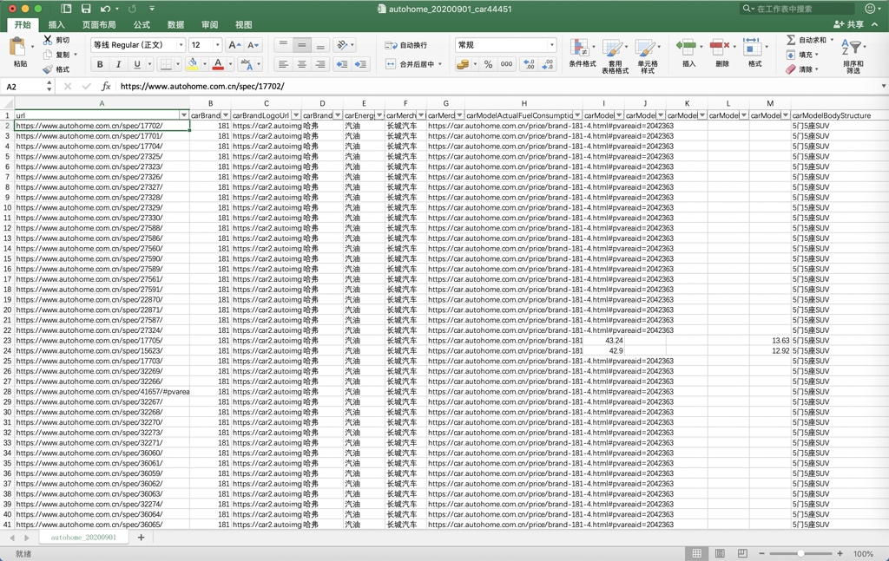
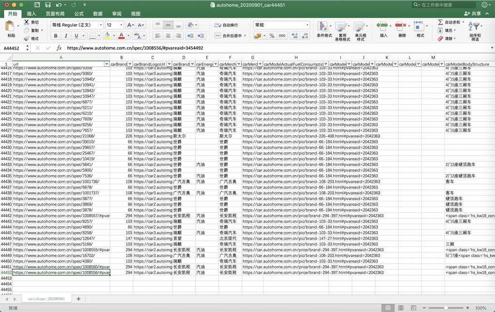

# 输出结果

## 全部结果：`autohome_20200901_car44451.xlsx`

* 在线下载：[autohome_20200901_car44451.xlsx](../../assets/file/autohome_20200901_car44451.xlsx)
* 截图效果
  * 
  * 

## 单个结果举例

单个车型车系的详细数据

### 汽油

* https://www.autohome.com.cn/spec/43593/

    ```json
    {
        "carBrandId": "33",
        "carBrandLogoUrl": "https://car2.autoimg.cn/cardfs/series/g26/M0B/AE/B3/100x100_f40_autohomecar__wKgHEVs9u5WAV441AAAKdxZGE4U148.png",
        "carBrandName": "奥迪",
        "carEnergyType": "汽油",
        "carMerchantName": "一汽-大众奥迪",
        "carMerchantUrl": "https://car.autohome.com.cn/price/brand-33-9.html#pvareaid=2042363",
        "carModelActualFuelConsumption": "",
        "carModelActualTestBrakeDistance": "",
        "carModelActualTestSpeedupTime": "",
        "carModelBodyStructure": "5门5座两厢车",
        "carModelDataSift2": "国VI",
        "carModelDataSift3": "1.4T",
        "carModelDataSift4": "7挡双离合",
        "carModelDriveType": "前置前驱",
        "carModelEngine": "1.4T 150马力 L4",
        "carModelEnvStandard": "国VI",
        "carModelGearBox": "7挡双离合",
        "carModelGroupName": "1.4升 涡轮增压 150马力 国VI",
        "carModelMaxPower": "110",
        "carModelMaxSpeed": "200",
        "carModelMaxTorque": "250",
        "carModelMiitCompositeFuelConsumption": "5.8",
        "carModelMsrp": "19.32万",
        "carModelName": "2020款 改款 Sportback 35 TFSI 进取型 国VI",
        "carModelOfficialSpeedupTime": "8.4",
        "carModelReleaseTime": "2020.04",
        "carModelSize": "4312*1785*1426",
        "carModelSpecId": "43593",
        "carModelSpecUrl": "https://www.autohome.com.cn/spec/43593/#pvareaid=3454492",
        "carModelWholeWarranty": "三年或10万公里",
        "carModelYear": "2020款",
        "carSeriesId": "3170",
        "carSeriesLevelId": "3",
        "carSeriesLevelName": "紧凑型车",
        "carSeriesMainImgUrl": "https://car3.autoimg.cn/cardfs/product/g27/M0A/C9/C8/380x285_0_q87_autohomecar__ChsEnV2uZRCAIMoIAAcQmM2ogcg307.jpg",
        "carSeriesMaxPrice": "23.46万",
        "carSeriesMinPrice": "19.32万",
        "carSeriesMsrp": "19.32-23.46万",
        "carSeriesMsrpUrl": "https://www.autohome.com.cn/3170/price.html#pvareaid=101446",
        "carSeriesName": "奥迪A3",
        "carSeriesUrl": "https://www.autohome.com.cn/3170/#levelsource=000000000_0&pvareaid=101594"
    }
    ```
* https://car.autohome.com.cn/config/spec/16147.html
    ```json
    {
        "carBrandId": "91",
        "carBrandLogoUrl": "https://car3.autoimg.cn/cardfs/series/g26/M05/AE/94/100x100_f40_autohomecar__wKgHEVs9tm6ASWlTAAAUz_2mWTY720.png",
        "carBrandName": "红旗",
        "carEnergyType": "汽油",
        "carMerchantName": "一汽红旗",
        "carMerchantUrl": "https://car.autohome.com.cn/price/brand-91-190.html#pvareaid=2042363",
        "carModelActualFuelConsumption": "",
        "carModelActualTestBrakeDistance": "",
        "carModelActualTestSpeedupTime": "",
        "carModelBodyStructure": "4门5座三厢车",
        "carModelDriveType": "后驱",
        "carModelEngine": "2.0T 204马力 L4",
        "carModelEnvStandard": "国IV(国V)",
        "carModelGearBox": "6挡手自一体",
        "carModelGroupName": "2.0升 涡轮增压 204马力",
        "carModelMaxPower": "150",
        "carModelMaxSpeed": "",
        "carModelMaxTorque": "260",
        "carModelMiitCompositeFuelConsumption": "9.8",
        "carModelMsrp": "37.98万",
        "carModelName": "2013款 2.0T 尊贵型",
        "carModelOfficialSpeedupTime": "",
        "carModelReleaseTime": "2013.05",
        "carModelSize": "5095*1875*1485",
        "carModelSpecId": "16147",
        "carModelSpecUrl": "https://www.autohome.com.cn/spec/16147/",
        "carModelWholeWarranty": "四年或10万公里",
        "carModelYear": "2013款",
        "carSeriesId": "2771",
        "carSeriesLevelId": "5",
        "carSeriesLevelName": "中大型车",
        "carSeriesMainImgUrl": "https://car3.autoimg.cn/cardfs/product/g27/M07/94/4F/380x285_0_q87_autohomecar__ChsEnV6MPieAbbAgAAiIIauI0dE436.jpg",
        "carSeriesMaxPrice": "31.78万",
        "carSeriesMinPrice": "25.28万",
        "carSeriesMsrp": "25.28-31.78万",
        "carSeriesMsrpUrl": "https://www.autohome.com.cn/2771/price.html#pvareaid=101446",
        "carSeriesName": "红旗H7",
        "carSeriesUrl": "https://www.autohome.com.cn/2771/#levelsource=000000000_0&pvareaid=101594"
    }
    ```
* https://www.autohome.com.cn/spec/46144/
    ```json
    {
        "carBrandId": "36",
        "carBrandLogoUrl": "https://car3.autoimg.cn/cardfs/series/g26/M00/AF/E7/100x100_f40_autohomecar__wKgHHVs9u6mAaY6mAAA2M840O5c440.png",
        "carBrandName": "奔驰",
        "carEnergyType": "汽油",
        "carMerchantName": "北京奔驰",
        "carMerchantUrl": "https://car.autohome.com.cn/price/brand-36-152.html#pvareaid=2042363",
        "carModelActualFuelConsumption": "",
        "carModelActualTestBrakeDistance": "39.01",
        "carModelActualTestEnduranceMileage": "",
        "carModelActualTestQuickCharge": "",
        "carModelActualTestSlowCharge": "",
        "carModelActualTestSpeedupTime": "9.01",
        "carModelBodyStructure": "5门5座SUV",
        "carModelDataSift2": "国VI",
        "carModelDataSift3": "1.3T",
        "carModelDataSift4": "7挡双离合",
        "carModelDriveType": "前置前驱",
        "carModelEngine": "1.3T 163马力 L4",
        "carModelEnvStandard": "国VI",
        "carModelGearBox": "7挡双离合",
        "carModelGroupName": "1.3升 涡轮增压 163马力 国VI",
        "carModelHorsePowerElectric": "",
        "carModelMaxPower": "120",
        "carModelMaxSpeed": "207",
        "carModelMaxTorque": "250",
        "carModelMiitCompositeFuelConsumption": "6.1",
        "carModelMiitEnduranceMileagePureElectric": "",
        "carModelMsrp": "30.38万",
        "carModelName": "2020款 GLA 200",
        "carModelOfficialSpeedupTime": "9",
        "carModelQuickCharge": "",
        "carModelQuickChargePercent": "",
        "carModelReleaseTime": "2020.07",
        "carModelSize": "4417*1834*1610",
        "carModelSlowCharge": "",
        "carModelSpecId": "46144",
        "carModelSpecUrl": "https://www.autohome.com.cn/spec/46144/#pvareaid=3454492",
        "carModelWholeWarranty": "三年不限公里",
        "carModelYear": "2020款",
        "carSeriesId": "3248",
        "carSeriesLevelId": "17",
        "carSeriesLevelName": "紧凑型SUV",
        "carSeriesMainImgUrl": "https://car3.autoimg.cn/cardfs/product/g27/M04/4F/39/380x285_0_q87_autohomecar__ChwFkV8eQZSAPD0IAAz4_sk-g8M069.jpg",
        "carSeriesMaxPrice": "30.38万",
        "carSeriesMinPrice": "30.38万",
        "carSeriesMsrp": "30.38-30.38万",
        "carSeriesMsrpUrl": "https://www.autohome.com.cn/3248/price.html#pvareaid=101446",
        "carSeriesName": "奔驰GLA",
        "carSeriesUrl": "https://www.autohome.com.cn/3248/#levelsource=000000000_0&pvareaid=101594"
    }
    ```

### 插电式混合动力

https://www.autohome.com.cn/spec/37077/

```json
{
    "carBrandId": "33",
    "carBrandLogoUrl": "https://car2.autoimg.cn/cardfs/series/g26/M0B/AE/B3/100x100_f40_autohomecar__wKgHEVs9u5WAV441AAAKdxZGE4U148.png",
    "carBrandName": "奥迪",
    "carEnergyType": "插电式混合动力",
    "carMerchantName": "奥迪(进口)",
    "carMerchantUrl": "https://car.autohome.com.cn/price/brand-33-79.html#pvareaid=2042363",
    "carModelActualFuelConsumption": "",
    "carModelActualTestBrakeDistance": "",
    "carModelActualTestEnduranceMileage": "",
    "carModelActualTestQuickCharge": "",
    "carModelActualTestSlowCharge": "",
    "carModelActualTestSpeedupTime": "",
    "carModelBodyStructure": "5门5座SUV",
    "carModelDataSift2": "国V",
    "carModelDataSift3": "2.0T",
    "carModelDataSift4": "8挡手自一体",
    "carModelDriveType": "前置四驱",
    "carModelEngine": "2.0T 252马力 L4",
    "carModelEnvStandard": "国V",
    "carModelGearBox": "8挡手自一体",
    "carModelGroupName": "2.0升 涡轮增压 252马力 国V",
    "carModelHorsePowerElectric": "128",
    "carModelMaxPower": "270",
    "carModelMaxSpeed": "228",
    "carModelMaxTorque": "700",
    "carModelMiitCompositeFuelConsumption": "2.4",
    "carModelMiitEnduranceMileagePureElectric": "56",
    "carModelMsrp": "79.08万",
    "carModelName": "2019款 55 e-tron",
    "carModelOfficialSpeedupTime": "5.9",
    "carModelQuickCharge": "2.5",
    "carModelQuickChargePercent": "",
    "carModelReleaseTime": "2018.11",
    "carModelSize": "5071*1968*1716",
    "carModelSlowCharge": "10.8",
    "carModelSpecId": "37077",
    "carModelSpecUrl": "https://www.autohome.com.cn/spec/37077/#pvareaid=3454492",
    "carModelWholeWarranty": "三年或10万公里",
    "carModelYear": "2019款",
    "carSeriesId": "4460",
    "carSeriesLevelId": "19",
    "carSeriesLevelName": "中大型SUV",
    "carSeriesMainImgUrl": "https://car3.autoimg.cn/cardfs/product/g3/M01/45/A0/380x285_0_q87_autohomecar__ChcCRVwuElKAXUwcAAfU0sgxuiw392.jpg",
    "carSeriesMaxPrice": "79.08万",
    "carSeriesMinPrice": "79.08万",
    "carSeriesMsrp": "79.08-79.08万",
    "carSeriesMsrpUrl": "https://www.autohome.com.cn/4460/price.html#pvareaid=101446",
    "carSeriesName": "奥迪Q7新能源",
    "carSeriesUrl": "https://www.autohome.com.cn/4460/#levelsource=000000000_0&pvareaid=101594"
}
```

### 纯电动

https://www.autohome.com.cn/spec/42875/

```json
{
    "carBrandId": "33",
    "carBrandLogoUrl": "https://car2.autoimg.cn/cardfs/series/g26/M0B/AE/B3/100x100_f40_autohomecar__wKgHEVs9u5WAV441AAAKdxZGE4U148.png",
    "carBrandName": "奥迪",
    "carEnergyType": "纯电动",
    "carMerchantName": "一汽-大众奥迪",
    "carMerchantUrl": "https://car.autohome.com.cn/price/brand-33-9.html#pvareaid=2042363",
    "carModelActualTestBrakeDistance": "",
    "carModelActualTestEnduranceMileage": "",
    "carModelActualTestQuickCharge": "",
    "carModelActualTestSlowCharge": "",
    "carModelActualTestSpeedupTime": "",
    "carModelBodyStructure": "5门5座SUV",
    "carModelDataSift2": "100KW",
    "carModelDataSift3": "265公里",
    "carModelDataSift4": "单速",
    "carModelDriveType": "前置前驱",
    "carModelGearBox": "电动车单速变速箱",
    "carModelGroupName": "电动 136马力",
    "carModelHorsePowerElectric": "136",
    "carModelMaxPower": "100",
    "carModelMaxSpeed": "150",
    "carModelMaxTorque": "290",
    "carModelMiitEnduranceMileagePureElectric": "265",
    "carModelMsrp": "22.68万",
    "carModelName": "2019款 Q2L e-tron 纯电智酷型",
    "carModelOfficialSpeedupTime": "",
    "carModelQuickCharge": "0.6",
    "carModelQuickChargePercent": "80",
    "carModelReleaseTime": "2019.11",
    "carModelSize": "4237*1785*1548",
    "carModelSlowCharge": "17",
    "carModelSpecId": "42875",
    "carModelSpecUrl": "https://www.autohome.com.cn/spec/42875/#pvareaid=3454492",
    "carModelWholeWarranty": "三年或10万公里",
    "carModelYear": "2019款",
    "carSeriesId": "5240",
    "carSeriesLevelId": "16",
    "carSeriesLevelName": "小型SUV",
    "carSeriesMainImgUrl": "https://car2.autoimg.cn/cardfs/product/g26/M08/5E/E9/380x285_0_q87_autohomecar__ChsEnFz-PK6AKWR5AAb_0TkX5cE445.jpg",
    "carSeriesMaxPrice": "23.73万",
    "carSeriesMinPrice": "22.68万",
    "carSeriesMsrp": "22.68-23.73万",
    "carSeriesMsrpUrl": "https://www.autohome.com.cn/5240/price.html#pvareaid=101446",
    "carSeriesName": "奥迪Q2L e-tron",
    "carSeriesUrl": "https://www.autohome.com.cn/5240/#levelsource=000000000_0&pvareaid=101594"
}
```

### 油电混合

https://car.autohome.com.cn/config/spec/35507.html

```json
{
    "carBrandId": "52",
    "carBrandLogoUrl": "https://car2.autoimg.cn/cardfs/series/g29/M02/B0/BE/100x100_f40_autohomecar__ChcCSFs91WqAGpOHAABVaN6-df4803.png",
    "carBrandName": "雷克萨斯",
    "carEnergyType": "油电混合",
    "carMerchantName": "雷克萨斯",
    "carMerchantUrl": "https://car.autohome.com.cn/price/brand-52-65.html#pvareaid=2042363",
    "carModelActualFuelConsumption": "",
    "carModelActualTestBrakeDistance": "",
    "carModelActualTestEnduranceMileage": "",
    "carModelActualTestQuickCharge": "",
    "carModelActualTestSlowCharge": "",
    "carModelActualTestSpeedupTime": "",
    "carModelBodyStructure": "5门5座两厢车",
    "carModelDataSift2": "",
    "carModelDataSift3": "",
    "carModelDataSift4": "",
    "carModelDriveType": "前驱",
    "carModelEngine": "1.8L 99马力 L4",
    "carModelEnvStandard": "国IV(国V)",
    "carModelGearBox": "E-CVT无级变速",
    "carModelGroupName": "1.8升 99马力",
    "carModelHorsePowerElectric": "82",
    "carModelMaxPower": "100",
    "carModelMaxSpeed": "",
    "carModelMaxTorque": "",
    "carModelMiitCompositeFuelConsumption": "4.6",
    "carModelMiitEnduranceMileagePureElectric": "",
    "carModelMsrp": "26.70万",
    "carModelName": "2018款 CT200h 多彩生活特别限量版",
    "carModelOfficialSpeedupTime": "",
    "carModelQuickCharge": "",
    "carModelQuickChargePercent": "",
    "carModelReleaseTime": "2018.08",
    "carModelSize": "4360*1765*1455",
    "carModelSlowCharge": "",
    "carModelSpecId": "35507",
    "carModelSpecUrl": "https://www.autohome.com.cn/spec/35507/",
    "carModelWholeWarranty": "六年或15万公里",
    "carModelYear": "2018款",
    "carSeriesId": "2063",
    "carSeriesLevelId": "3",
    "carSeriesLevelName": "紧凑型车",
    "carSeriesMainImgUrl": "https://car2.autoimg.cn/cardfs/product/g29/M09/FB/2F/380x285_0_q87_autohomecar__ChsEfl9GUImAT_62AAnvWT7-yrA464.jpg",
    "carSeriesMaxPrice": "28.20万",
    "carSeriesMinPrice": "21.50万",
    "carSeriesMsrp": "21.50-28.20万",
    "carSeriesMsrpUrl": "https://www.autohome.com.cn/2063/price.html#pvareaid=101446",
    "carSeriesName": "雷克萨斯CT",
    "carSeriesUrl": "https://www.autohome.com.cn/2063/#levelsource=000000000_0&pvareaid=101594"
}
```
